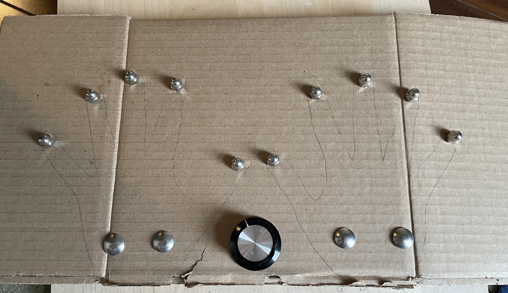

# Physical interface

There's just a handful of days left to make some kind of sturdy physical interface for this thing.

I picked up a birch board and a handful of bolts and cap nuts, with the thinking that I can just drill holes and have caps as contacts in finger and palm positions. To put the potentiometer on the board though, I'd need to make a fairly deep pocket cut with a router. Do they have a router at the school woodshop? Will they let me use it? There might have been a hand router at Foulab, will they let me in and let me use it? I have a hand router back in Austin, and plenty of interesting junk that would have made for a better physical interface but I have to work with what I have here. I am feeling anxious about this, and I wish I had anticipated having to build something for this sketch that I could have made back in Texas.

I added a one second hold after a figure is displayed to keep from just spamming results.

cardboard prototype:

