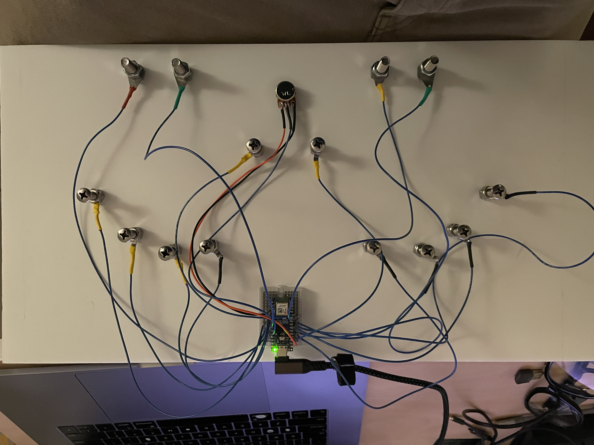

# Testing

I have the panel all wired up and everything works but two fingers and the potentiometer (right ring finger and left pinky finger are out)

I'm supposed to go to radio snack tomorrow at 6 so I have time to fix it. I am hoping there is a multimeter at the concordia makerspace I can use tomorrow and maybe some heat shrink tubing. I elected to put it on on a mini proto board so the wires have little crimped header pins and those might be touching one another or something. It could also be a couple of poorly crimped pins. circuit tester will tell me tomorrow.

I'm still worried this will be underwhelming and boring compared to whatever else is in there. I also am torn between wanting to make something fun and actually still being unsure about my motivations behind this. I feel like there is some additional twist that would make this really click other than the fact that I like how the random text and color/tile stuff is working. Maybe that is enough and I should let this one be what it is. If I dug into the subject matter more I might be percieved at mocking other artists like Paloma, who invited me to do this and who is genuinely engaged with Tarot from a traditional spiritualist angle from what I can tell. That is definitely not my intent.

The horror of my wiring while testing. I'll make this neat once I ensure everything works.
