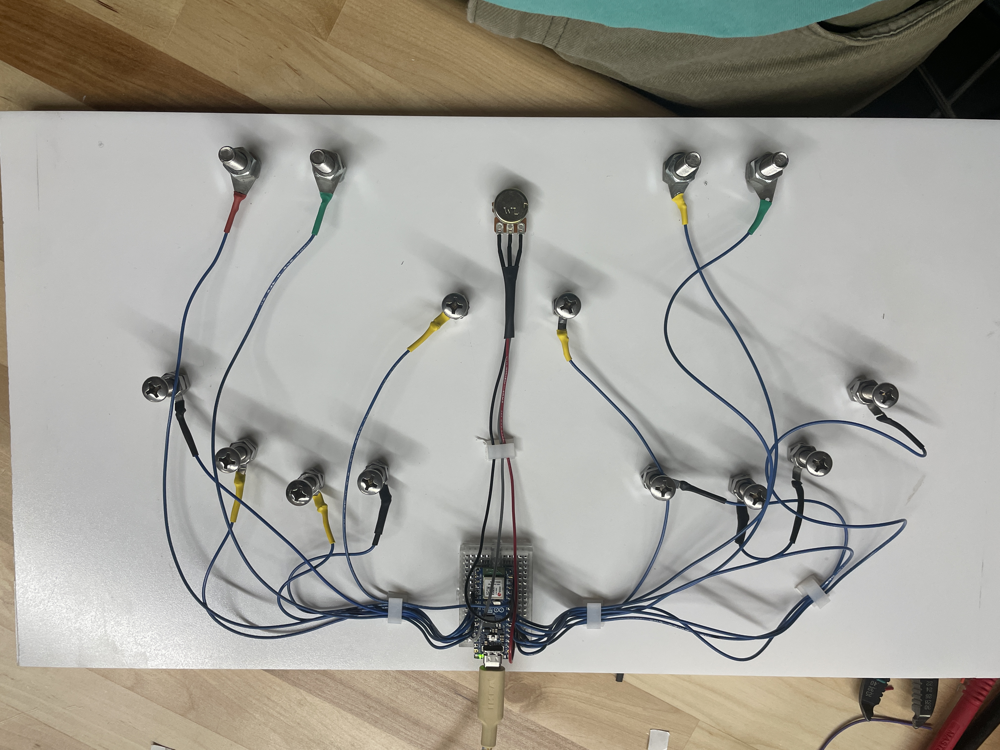

# Repair

dead finger pins were bad crimped pins on the end of the wires, fixed

potentiometer wires test good, but maybe I am incorrectly setting D9 to an analog pin on the arduino nano 23.

It was a bad potentiometer. Everything works now. I added a couple more "opposites" symbols as potentiometer scale indicators with a random chance of appearing along with the venus and mars symbols. Done? Done!

Testing it I can't help but feel a little like I've made a baby toy for adults. one of those busyboards you poke at and see what happens, which nowadays I suppose is another confrontation with the machine.

I wish I had a little more time to saw the acylic down more so that the controls were centered and there was less overhang, but maybe it will be fine.
